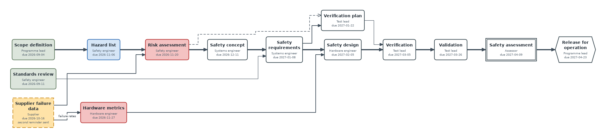
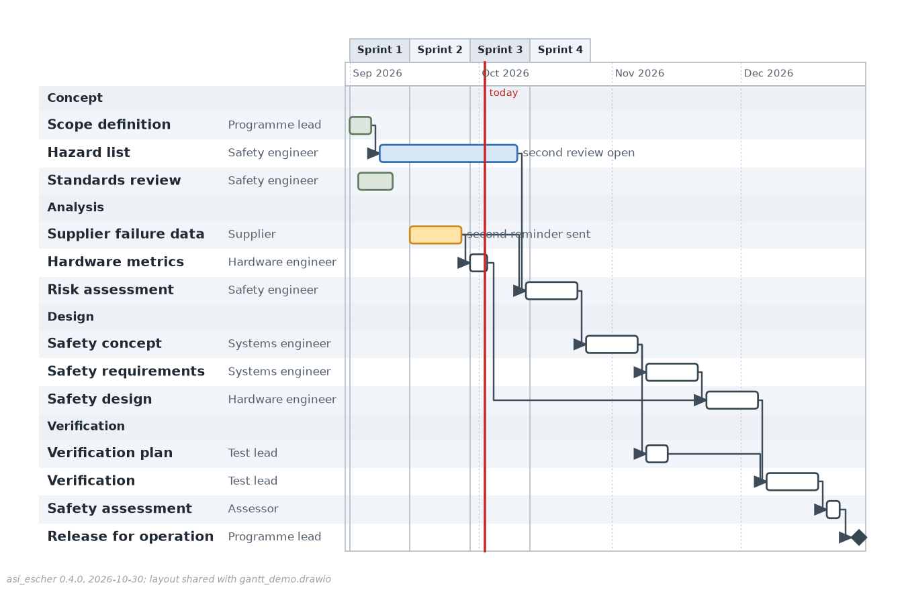

# asi_escher

One of the [ASI FuSa tools](https://github.com/c00289/c00289/blob/main/README.md) by Roy Mendoza; the master README there lists every sibling.

Pure-Python diagram generator for engineering documentation. Describe a
diagram in a few lines of Python (or a JSON file), and asi_escher lays it out,
writes it as an editable **draw.io** file and renders it to **PNG** and
**SVG**, plus **Graphviz DOT** and **Mermaid** source, with no draw.io,
Graphviz, Node or browser needed. Version **0.4.0**, alpha.

Supported diagram families:

| Family | Node kinds | Typical use |
|---|---|---|
| Activity | start, end, flowfinal, action, decision, merge, fork, join, note, object, swimlanes | processes, safety reactions, handovers between actors |
| Flowchart | io, process, document, database + the activity kinds | procedures, test routines |
| State machine | state, start, end | modes and transitions |
| SysML BDD / IBD / REQ | block, part, requirement + composition, aggregation, generalization, connector, itemflow, satisfy, derive, verify, refine, allocate | structure, interfaces, traceability |
| STPA control structure | controller, human_controller, controlled_process, environment, sensor, actuator, external_system, note + control_action, feedback | hazard analysis: who controls what, through which signals |
| Chain | event, milestone, gate, external + blocks, enables, informs | a plan's precedence network: what is a blocker for what, the critical path |
| Gantt | task, milestone + depends; periods and a today line | the plan on a time scale: bars by date under the sprints, what is late |


## Install

Requires Python 3.13 or newer. The only runtime dependencies are matplotlib
and Pillow.

```bash
# for development inside this folder
uv sync

# as a dependency of another project, from a checkout
uv add --editable ../asi_escher      # or: pip install ../asi_escher
```

### From a sibling project

This repository sits next to its siblings and the `Roy's Brain` folder:

```
OneDrive - Capgemini/
├── asi_dewey/             <- primary tool: working-knowledge store
├── asi_kletz/             <- primary tool: safety plan
├── asi_escher/            <- this repo
├── asi_gutenberg/         <- document generator (depends on this repo)
├── asi_hopper/            <- gateway: read-only Jira door
└── Roy's Brain/           <- notes, corpus, datasets
```

Each consumer declares the dependency once with a uv path source. From the
asi_gutenberg folder (or any other sibling):

```bash
uv add --editable ../asi_escher
```

The command writes the two lines below into the consumer's pyproject
(with its own relative path), locks it, installs it into the consumer's
`.venv`, and from then on `from asi_escher import Diagram, build` works
there. Because the install is editable, pulling a newer asi_escher is picked
up without reinstalling; only a changed dependency list needs a `uv sync`.

```toml
[project]
dependencies = ["asi-escher"]

[tool.uv.sources]
asi-escher = { path = "../asi_escher", editable = true }
```

A pinned git source works the same way:
`asi-escher = { git = "https://github.com/c00289/asi_escher", tag = "v0.4.0" }`.

This folder lives in OneDrive, which rejects the hardlinks uv normally makes
from its cache; `pyproject.toml` therefore sets `tool.uv.link-mode = "copy"`
so plain `uv sync` works. Consumers in OneDrive need the same setting, or
`--link-mode=copy` on the command line.

## Quick start

```python
from asi_escher import Diagram, build

d = Diagram("Emergency Stop", "activity")
d.start()
d.action("press", "Press E-stop")
d.decision("agree", "Channels agree?")
d.action("inhibit", "Open drive inhibit relay")
d.action("flag", "Flag channel discrepancy")
d.end()
d.chain("start", "press", "agree")
d.edge("agree", "inhibit", "yes")
d.edge("agree", "flag", "no")
d.edge("flag", "inhibit")
d.edge("inhibit", "end")

paths = build(d, "out")        # out/emergency_stop.drawio and out/emergency_stop.png
print(paths["png"], paths["size"], paths["issues"])
```

`build()` is the one-call pipeline. The individual steps are also public when
you need control over them:

```python
from asi_escher import layout, render, to_drawio, to_dot, to_mermaid, LayoutOptions

layout(d, LayoutOptions(ranksep=70, nodesep=40))   # positions, edge routes, canvas size
fig = render(d, png="e.png", svg="e.svg", dpi=200)  # matplotlib Figure is returned too
xml = to_drawio(d)                                  # str, the draw.io file with the layout's positions
dot = to_dot(d)                                     # str, paste into Graphviz
mmd = to_mermaid(d)                                 # str, paste into Markdown
```

### Formats

| Key | Produces | Made by |
|---|---|---|
| `drawio` | `<slug>.drawio` | `to_drawio`, the positions of the layout |
| `png` | `<slug>.png` | the renderer, the same layout |
| `svg` | `<slug>.svg` | the renderer, the same layout |

`asi_escher.FORMATS` is this set, the one the sibling tools offer in their
export dialogs; `DEFAULT_FORMATS` is `("drawio", "png")`, the file to edit
and the picture to look at, and what `build()` writes when `formats` is not
given. `build()` also accepts `dot` and `mmd` (`ALL_FORMATS` lists all five).
The `.drawio` file is the real draw.io artefact: uncompressed mxGraph XML
(`compressed="false"`) with one vertex cell per box whose geometry is the
layout's x, y, width and height, one edge cell per arrow with the routed
points as waypoints and the label as its value, so draw.io or the VS Code
draw.io extension opens it with every box exactly where asi_escher put it
and a person can refine it by hand from there. The PNG and SVG are
asi_escher's renderings of that same layout, not draw.io exports.

Every output says so: the `.drawio` carries an XML comment after the
`<mxfile>` opening and a small grey note under the drawing, and the PNG and
SVG a grey footer line in the bottom-left corner ("asi_escher 0.4.0,
2026-10-29; layout shared with `<slug>.drawio`"). `provenance=False` on
`build()`, `render()` or `to_drawio()` (`--no-provenance` on the command
line) switches the marks off; `name=` sets the stem they name.

### Control structures

The `control_structure` kind draws an STPA control structure: boxes with a
title, a responsibility, an orange algorithms section and a blue process
model, joined by red control actions pointing down the hierarchy and blue
feedback pointing up, each carrying numbered signals drawn one per line.

```python
d = Diagram("Demo Loader Control Structure", "control_structure")
d.controller("operator", "Remote Operator", kind="human_controller",
             responsibility="Starts and stops the mission.",
             algorithms=[("O1", "Mission start / stop decision")],
             process_model=("Operator process model", ["Mission state (updated by FB-01)"]))
d.controller("vehicle", "Vehicle Controller", responsibility="Turns a mission into drive commands.")
d.controller("machine", "Loader Machine", kind="controlled_process")
d.controller("site", "Work Site", kind="environment")
d.control_action("operator", "vehicle", ["CA-01 Mission Start", "CA-02 Mission Stop"])
d.feedback("vehicle", "operator", ["FB-01 Mission State"])
d.control_action("vehicle", "machine", ["CA-20 Drive Command"])
d.feedback("machine", "vehicle", ["FB-10 Machine State"])
d.control_action("machine", "site", ["CA-40 Material Moved"])
d.note("n1", "Stops within 2 s of any fault", attached_to="vehicle")
```

`kind` sets the box: plain for a `controller` and an `external_system`, a
rounded box for a `human_controller`, a double border for the
`controlled_process`, a dashed border for the `environment`, small shapes for
a `sensor` and an `actuator`. A note attached to a box floats beside it. DOT
and Mermaid export the sections as label lines, the draw.io file as an HTML
label with the same colours. `docs/control_structure_spec.json` is the
bundled example as a JSON spec.

The layout follows the control hierarchy, in tiers. A box sits one tier
below the deepest box that sends it a control action; boxes that nobody
commands are peers and share the top tier side by side; a box commanded
from two tiers sits below both. Feedback never moves a box of the
hierarchy: a box that only reports (a sensor, the environment) sits below
the boxes it reports to, one that only listens (an external system taking
reports) just above the nearest box it hears from, and the environment at
the bottom beside the controlled process. A control action between two
peers is a request, not a step down: when the sender's every other control
action reaches past the receiver's own subordinates into the receiver's
domain (one operator asking another for a stop while itself commanding the
controllers and the process further down), the two stay
on one tier and the arrow runs horizontally between them, its answer
beneath it. Between two tiers the control action keeps to the left of a
pair of arrows and the feedback to the right; each arrow jogs just under
its tier and runs straight into its target with its signal stack hanging
beside it in the channel, and a channel grows until the stacks in it fit,
so the labels never overlap. `LayoutOptions.for_kind("control_structure")`
gives the kind its wider gaps, and a box with many algorithms is drawn
wider so the arrows on its edge keep apart.


### Chains

The `chain` kind draws a precedence network: the events of a plan and what
is a blocker for what, so a reader sees how everything is chained, which
events are stuck and why, and the longest run from start to finish. The
model is plain data a plan can feed (asi_kletz's Safety Plan deliverables
and the Jira "blocks" links are the intended source), and every question a
plan asks of it has a method.

```python
d = Diagram("Demo Safety Programme Chain", "chain")
d.event("scope", "Scope definition", status="done", owner="Programme lead", due="2026-09-04")
d.event("supplier", "Supplier failure data", kind="external", status="late", owner="Supplier",
        due="2026-10-16", note="second reminder sent")
d.event("hazards", "Hazard list", status="active", owner="Safety engineer", due="2026-11-06")
d.event("risk", "Risk assessment", owner="Safety engineer", due="2026-11-20")
d.event("release", "Release for operation", kind="milestone", effort=1)
d.blocks("scope", "hazards")
d.blocks("hazards", "risk")
d.blocks("supplier", "risk", label="failure rates")
d.blocks("risk", "release")
d.blocks("hazards", "release", kind="informs")

d.status("risk")          # "blocked": a predecessor that blocks it is late
d.blockers("release")     # ["risk", "supplier", "hazards"]: not done, nearest first
d.critical_path()         # ["scope", "hazards", "risk", "release"]
d.predecessors("risk"), d.successors("risk"), d.upstream("release"), d.downstream("scope")
d.cycles()                # [] for a well-formed chain
```

`event(id, title, *, status="pending", kind="event", owner="", due="",
note="", effort=None)` adds an event. `status` is one of `done`, `active`,
`blocked`, `pending`, `late` and sets the box colour: done green-grey, active
blue, blocked pinkish red (`#F4C2C2`), pending white, late amber. `kind` is
one of `event` (a rounded box), `milestone` (a box with pointed ends), `gate`
(a double border), `external` (a dashed border: something somebody else
delivers). The owner and the due date are drawn as small lines under the
title, the note as a small italic line. `blocks(predecessor, successor, *,
kind="blocks", label="")` adds an edge: `blocks` (solid, an arrowhead; the
Jira "blocks" link), `enables` (solid, thin), `informs` (dashed, an open
arrowhead; it orders nothing). A label is drawn on the edge when given.

A `blocked` status is derived when not given: a `pending` event whose direct
predecessor on a `blocks` edge is `late`, or marked `blocked`, is drawn
blocked. A pending or active predecessor is the normal course of a plan and
colours nothing; the pink boxes are the ones directly waiting on trouble.
`d.status(id)` is the effective status, `d.statuses()` all of them.

The queries: `predecessors(id)` and `successors(id)` are the direct
neighbours on `blocks` and `enables` edges; `upstream(id)` and
`downstream(id)` the transitive ones, in dependency order (by column, then
as listed); `blockers(id)` the events that stand between `id` and being
workable: every event that is not done on a chain of `blocks` edges upstream
of it, up to the first done one on each chain, nearest first;
`critical_path()` the longest chain of `blocks` / `enables` edges by count,
or by the sum of `effort` where events carry one (an event without effort
counts 1); `cycles()` every cycle of the precedence edges as the ids it runs
through, and `back_edges()` the edges that close them. A cycle is a
`LayoutIssue` of kind `cycle` and the layout still completes, drawing the
named edge backwards through the channel.

The layout runs left to right. An event's column is one past the deepest of
its `blocks` / `enables` predecessors, an event with no predecessor sits in
column 0, and `informs` edges move nothing (one that would point backwards
is drawn through the channel). The critical path is kept on one straight
row with its arrows thicker and leaving on the centre line, the other
branches above and below with their long edges jogging once near the
target. `LayoutOptions.for_kind("chain")` gives the kind its spacing.
`render(d, focus="design")` (`--focus ID` on `export`, `focus=` on
`build()`) emphasises one event's blocker chain: it, its blockers and the
`blocks` edges between them are drawn as usual, everything else is dimmed.

DOT exports the kind with the status colours, a hexagon for a milestone, a
double border for a gate, a dashed border for an external event, the
critical path's edges thicker and `informs` dashed without rank; Mermaid as
`flowchart LR` with one `classDef` per status and every event in the class
of its effective status; the draw.io file with the same shapes, colours and
widths. `docs/chain_spec.json` is the bundled demo as a JSON spec in the
kind's own form, events and edges as plain lists:

```json
{
  "title": "Demo Safety Programme Chain",
  "kind": "chain",
  "events": [
    {"id": "scope", "title": "Scope definition", "status": "done", "owner": "Programme lead", "due": "2026-09-04"},
    {"id": "supplier", "title": "Supplier failure data", "kind": "external", "status": "late", "owner": "Supplier"},
    {"id": "risk", "title": "Risk assessment", "owner": "Safety engineer", "due": "2026-11-20"}
  ],
  "edges": [
    {"src": "scope", "dst": "risk"},
    {"src": "supplier", "dst": "risk", "label": "failure rates"},
    {"src": "scope", "dst": "supplier", "kind": "informs"}
  ]
}
```

`to_dict()` writes a chain in this form and `from_dict()` reads it (a spec
with `events` is a chain). `asi-escher export chain_spec.json --format png`
renders it; `asi-escher chain chain_spec.json --blockers design` prints the
critical path, the cycles, the effective statuses and the blockers of the
named events as JSON (without `--blockers`, of every event that has any).
What a consumer passes: one `event()` per deliverable or ticket with its
status (done / in progress / to do mapped to `done` / `active` / `pending`,
`late` when the due date has passed), owner, due date and kind, and one
`blocks()` per "blocks" link; escher derives the blocked ones, the blockers
and the critical path.



### Gantt charts

The `gantt` kind draws a plan on a time scale: one row per task, its bar
from its start date to its end date on a shared day scale, the periods
(sprints, quarters) and the months as the header, a group band wherever a
new group starts, the dependencies as elbows from the end of one bar to the
start of the next, and a today line. It is the chain's companion: the chain
says what blocks what, the gantt says when.

```python
d = Diagram("Demo Safety Programme Plan", "gantt")
d.period("Sprint 1", "2026-09-01", "2026-09-14")
d.period("Sprint 2", "2026-09-15", "2026-09-28")
d.mark("2026-09-17")
d.task("scope", "Scope definition", "2026-09-01", "2026-09-05", status="done", owner="Programme lead",
       group="Concept")
d.task("hazards", "Hazard list", "2026-09-08", "2026-09-19", status="active", owner="Safety engineer",
       group="Concept", note="second review open")
d.task("supplier", "Supplier failure data", "2026-09-08", "2026-09-16", owner="Supplier", group="Analysis")
d.milestone("release", "Release for operation", "2026-09-28", owner="Programme lead", group="Analysis")
d.depends("scope", "hazards")
d.depends("hazards", "release")

d.status("supplier")      # "late": not done and its end is before today
d.statuses()              # the effective status of every task
```

`task(id, title, start, end, *, status="pending", kind="task", owner="",
group="", note="", effort=None)` adds a task; the dates are ISO
`YYYY-MM-DD` strings and the end is inclusive, so a one-day task spans one
day of the scale (`end` defaults to `start`). `status` is one of the chain's
(`done`, `active`, `blocked`, `pending`, `late`) and colours the bar the
same way; `kind` is `task` (a bar) or `milestone` (a solid diamond on one
date; `milestone(id, title, date)` is the shortcut). The title is drawn in a
bold column on the left, the owner in a small column beside it, the note in
small grey text right of the bar; tasks with the same `group` sit under one
band (list them together). `depends(predecessor, successor)` adds the one
edge kind, `depends`: an elbow from the end of the predecessor's bar to the
start of the successor's. `period(label, start, end)` names a span of the
scale, drawn as a band of the header with a grid line at its start;
`mark(today)` sets the today line (`mark(None)` removes it).

A `late` status is derived when not given: a `pending` or `active` task
whose end is before `today` is drawn late (amber); a `done` task never is.
`d.status(id)` is the effective status, `d.statuses()` all of them.

The layout is not a graph layout: the rows follow the order the tasks were
added (a group row opens whenever the group changes), the bars follow their
dates at `LayoutOptions.day_px` pixels per day (default 4; `--day-px` on the
command line; the scale never shrinks below 240 px), and the canvas is as
wide as the title and owner columns, the scale and the longest note need. A
dependency whose successor starts after its predecessor ends runs forward
through one vertical channel, placed just before the successor's bar unless
another bar sits there; one whose successor starts earlier goes out, along
the row boundary and back in, and is a back edge. A dependency that has to
pass through another task's bar is a `LayoutIssue` of kind
`edge_through_node`.

DOT exports every task as a box (a milestone as a diamond) in its status
colours with the owner and the dates under the title; Mermaid as a native
`gantt` (one `section` per group, `done` / `active` / `crit` tags from the
effective status, `milestone` for a milestone, the dependencies as comments
since Mermaid draws none); the draw.io file carries the whole chart, the
header, bands, grid, columns, notes and today line as cells under the bars,
every bar where the layout put it. `docs/gantt_spec.json` is the bundled
demo as a JSON spec in the kind's own form:

```json
{
  "title": "Demo Safety Programme Plan",
  "kind": "gantt",
  "today": "2026-10-02",
  "periods": [{"label": "Sprint 1", "start": "2026-09-01", "end": "2026-09-14"}],
  "tasks": [
    {"id": "scope", "title": "Scope definition", "start": "2026-09-01", "end": "2026-09-05",
     "status": "done", "owner": "Programme lead", "group": "Concept"},
    {"id": "release", "title": "Release for operation", "start": "2026-12-28", "end": "2026-12-28",
     "kind": "milestone", "owner": "Programme lead", "group": "Verification"}
  ],
  "edges": [{"src": "scope", "dst": "release"}]
}
```

`to_dict()` writes a gantt chart in this form and `from_dict()` reads it (a
spec with `tasks` is a gantt chart). `asi-escher export gantt_spec.json
--format png --day-px 6` renders it. What a consumer passes: one `task()`
per deliverable with the dates its schedule gives it (asi_kletz's sprint
scheduler: the start of the first sprint a deliverable takes points from
and the end of the one its last point lands in), one `period()` per sprint,
`mark()` with the date of the day, and one `depends()` per "blocks" link.



### Legibility: the OCR quality gate

A diagram is only competent when a reader can read it, so a rendered PNG can
be read back with the built-in Windows OCR engine (`Windows.Media.Ocr`
through PowerShell 5.1, no Tesseract) and compared with what it was meant to
say: every node title, every signal id (`CA-01`, `FB-12`) and, in a control
structure, every algorithm code and process-model title; in a chain, every
title. `build(d, out,
ocr=True)` (`--ocr` on the command line) adds the report under `"ocr"` (an
`OcrReport`: `verdict`, `lines`, `found`, `missing`, `competent`) and one
`LayoutIssue` of kind `ocr` per unreadable label; `ocr_check(png_path,
expected)` runs it on any picture and `asi-escher verify <png> --expect
LABEL...` from the shell (exit 0 competent, 1 unreadable labels, 3 engine
unavailable; `--json` prints the report as JSON). The match is tolerant:
case, punctuation and accents ignored, words found in order on one OCR line
or across adjacent ones, hyphenation and the engine's usual confusions
(`O`/`0`, `I`/`l`/`1`, `rn`/`tn` for an italic `m`) folded. The PowerShell side writes UTF-8 and the Python side
reads UTF-8, so a label with a bullet, a dash or an accent (`•`, `–`, `é`)
comes back intact instead of as a control byte of the console code page,
which used to break the JSON report and make the gate say `unavailable`.
When the engine is not there (no Windows, no language pack, as on CI) the
report says `ocr unavailable` as one issue and never fails a build. The gallery runs the
gate on every control structure and chain; the test suite asserts the bundled
`control_structure_demo` and `chain_demo` are competent whenever the engine is available.

## Command line

The package installs an `asi-escher` command (also `python -m asi_escher`).

```bash
asi-escher export diagram.json --out out                     # <slug>.drawio and <slug>.png
asi-escher export diagram.json --out out --format svg        # one format, repeatable
asi-escher export diagram.json --out out --all               # drawio, png and svg
asi-escher build diagram.json -o out            # render one or more JSON specs, all five formats
asi-escher build a.json b.json --formats svg,mmd
asi-escher gallery -o out                       # all bundled examples + index.html
asi-escher example state_autonomy_modes -o out  # one bundled example
asi-escher verify out/diagram.png --expect "Vehicle Controller" CA-01 V1   # the OCR gate
asi-escher chain docs/chain_spec.json --blockers design   # a chain's blockers and critical path as JSON
asi-escher list                                 # names of bundled examples
```

`export` writes the format set (`--format drawio|png|svg`, repeatable;
`--all` for the three; default `drawio` and `png`), with `--name STEM`,
`--dpi N`, `--no-provenance`, `--ocr` and, for a chain, `--focus ID`. `build`, `gallery` and `example`
share the options `-o/--out DIR` (default `out`), `--dpi N` (PNG resolution,
default 160), `--formats drawio,png,svg,dot,mmd` (any subset, default all),
`--ranksep PX` and `--nodesep PX` (layout spacing), `--no-provenance` and
`--ocr`. `build` also takes `--name STEM` for a single spec; `build` and
`export` read one spec from stdin when the file argument is `-`.
`asi-escher verify PNG --expect LABEL... [--json]` is the OCR gate on its
own; `asi-escher chain SPEC [--blockers ID...]` the chain queries as JSON
(see Chains). `asi-escher --version` prints the installed version.

Run `asi-escher gallery` and open `out/index.html` to see every diagram
family rendered, with its DOT and Mermaid source alongside. Layout issues
(see below) are printed to stderr per diagram.

The eighteen bundled examples (`src/asi_escher/examples.py`), all themed
around an autonomous wheel loader and its safety system:

| Family | Examples |
|---|---|
| Activity | `activity_load_cycle`, `activity_swimlanes_estop`, `activity_fork_join_post`, `activity_object_flow`, `swimlanes_lr_dispatch` |
| Flowchart | `flowchart_fault_response`, `flowchart_pipeline_lr`, `flowchart_calibration_loops`, `flowchart_fusa_lifecycle`, `stress_random_dag` |
| State machine | `state_autonomy_modes`, `state_estop_channel` |
| SysML | `bdd_wheel_loader`, `bdd_safety_system`, `ibd_safety_controller`, `req_safety_requirements` |
| Control structure | `control_structure_demo` |
| Chain | `chain_demo` |

### JSON spec

A spec is the JSON form of `Diagram.to_dict()`. Everything except `title`,
node `id` and edge `src`/`dst` is optional.

```json
{
  "title": "Login",
  "kind": "flowchart",
  "direction": "TB",
  "lanes": [{"id": "user", "title": "User"}, {"id": "sys", "title": "System"}],
  "nodes": [
    {"id": "start", "kind": "start", "lane": "user"},
    {"id": "enter", "label": "Enter credentials", "lane": "user"},
    {"id": "check", "label": "Valid?", "kind": "decision", "lane": "sys"},
    {"id": "end", "kind": "end", "lane": "sys"}
  ],
  "edges": [
    {"src": "start", "dst": "enter"},
    {"src": "enter", "dst": "check"},
    {"src": "check", "dst": "end", "label": "yes"},
    {"src": "check", "dst": "enter", "label": "no", "style": "dashed"}
  ]
}
```

See [docs/example_spec.json](docs/example_spec.json) for a complete example,
[docs/control_structure_spec.json](docs/control_structure_spec.json) for a
control structure and [docs/chain_spec.json](docs/chain_spec.json) for a
chain in its own `events` form (see Chains). Node fields: `id`, `label`, `kind`, `lane`,
`stereotype`, `compartments` (list of `[title, [lines]]`), `fill`, `stroke`,
and for a control structure `responsibility`, `algorithms` (list of
`[code, name]`), `process_model` (`[title, [entries]]`) and, on a note,
`attached_to`; a chain event's `status`, `owner`, `due`, `note` and
`effort` travel on any node when set. Edge fields: `src`, `dst`, `label`, `kind`, `style` (`solid`,
`dashed`, `dotted`), `src_port`, `dst_port`, and `signals` (a list of lines;
the label is their join when no label is given).

## Building diagrams in Python

`Diagram(title, kind="activity", direction="TB", frame=None)`

* `kind` is one of `activity`, `flowchart`, `state`, `bdd`, `ibd`, `req`,
  `control_structure`, `chain`. It selects the Mermaid diagram type and, for
  a control structure or a chain, the layout rules above; the renderer draws
  any node kind in any diagram.
* `direction` is `TB` or `LR`; when not given, a chain runs left to right
  and every other kind top to bottom.
* `frame` draws a SysML diagram frame with the given header, e.g.
  `"bdd [Package] WheelLoader"`.

Shorthand constructors: `start()`, `end()`, `action()`, `decision()`,
`merge()`, `fork()`, `join()`, `note(id, label, lane=None, attached_to=None)`,
`state()`, `block()`, `requirement()`, `controller(id, title, kind=...,
responsibility=..., algorithms=[(code, name)], process_model=(title,
[entries]))`, `event(id, title, *, status, kind, owner, due, note, effort)`,
plus the general `node(id, label, kind, **fields)`. Edges come
from `edge(src, dst, label="", kind="flow", style="solid", src_port=None,
dst_port=None)`, `chain(*ids, labels=[...])`, `control_action(src, dst,
[signals])`, `feedback(src, dst, [signals])` and `blocks(predecessor,
successor, *, kind, label)`. Swimlanes come from
`lane(id, title)`; when a diagram has lanes, every node must name one.

Invalid input raises early: unknown kinds, duplicate ids, edges to missing
nodes and nodes outside any lane are all `ValueError`/`KeyError` at build
time, not at render time.


## Layout engine

The layout is a deterministic layered (Sugiyama-style) algorithm:

1. cycle removal by DFS back edges (back edges are routed in a channel on
   the right, or at the bottom for left-to-right diagrams);
2. longest-path layering, with side inputs such as notes pulled next to
   their consumer (a control structure layers by its control hierarchy, in
   the tiers described above; a chain by its `blocks` / `enables` edges,
   with the critical path pinned on one row);
3. dummy nodes for edges that span several layers;
4. barycenter ordering, lane-aware when swimlanes are present;
5. per-component coordinate balancing and chain straightening, with
   components packed side by side;
6. orthogonal edge routing that only jogs in the gaps between layers;
7. edge-label placement that avoids nodes and other labels, with layer gaps
   widened to fit labels in left-to-right diagrams.

`LayoutOptions` exposes `ranksep`, `nodesep`, `margin`, `lane_pad`,
`lane_header`, `iterations` and `back_channel`; `LayoutOptions.for_kind(kind)`
gives the defaults `layout()` uses when none are passed (wider gaps for a
control structure). Text is measured with the DejaVu Sans font bundled with
matplotlib, so output is identical on every machine.

### Layout issues

When the engine cannot find a clean result it still produces a drawing, but
it says so. After `layout()` (or `build()`), `diagram.issues` holds one
`LayoutIssue` per problem:

| kind | meaning |
|---|---|
| `label_overlap` | an edge label had to be placed touching a node or another label |
| `edge_through_node` | a routed edge segment passes through a node it does not connect |
| `ocr` | the OCR gate could not read a label in the PNG, or the engine was unavailable (only with `ocr=True`) |
| `cycle` | a chain's precedence edges run in a circle; the named edge is drawn backwards |

Each issue carries a `message`, the `edge` `(src, dst)` and, where relevant,
the `node` id. A single `LayoutWarning` (a `UserWarning` subclass) is also
emitted per diagram so that hosts which do nothing special still see it;
silence it with `warnings.filterwarnings("ignore", category=LayoutWarning)`
or turn it into an error in tests. None of the bundled examples produce
issues, and the test suite enforces that.


## Using it inside a larger tool

* No global state. The renderer uses the object-oriented matplotlib API,
  never calls `pyplot`, selects no backend and restores rcParams after each
  call. It is safe inside applications that use matplotlib themselves.
* `render()` accepts file paths or file-like objects and returns the
  `Figure`, so you can write to memory, embed in a GUI or save as PDF.
* The model is plain data. `Diagram.to_dict()` / `Diagram.from_dict()` give
  a JSON-serialisable interchange format; the author's labels are never
  modified by layout (wrapped text lives in `Node.lines`).
* `layout()` can be re-run on the same diagram after edits; stale layout
  state is discarded.
* Degraded results are reported, never hidden (see Layout issues).
* The package ships `py.typed`; everything is typed, deterministic and
  covered by the test suite.

## Theming

`render(d, theme={...})` overrides any entry of `asi_escher.THEME`, a dict of
colours keyed by node kind (`(fill, stroke)` pairs) and by role (`bg`,
`edge`, `label_bg`, `lane_a`, `lane_b`, `frame`, `bar`). Individual nodes
take `fill=` and `stroke=` too.

## Development

```bash
uv sync                      # create .venv with dev tools
uv run pytest                # tests, including geometric invariants on every example
uv run ruff check src tests  # lint
uv run asi-escher gallery    # regenerate out/ for a visual check
uv build                     # wheel + sdist in dist/
```

The README pictures in `docs/img` are `asi-escher example NAME --formats png
--no-provenance --dpi 100` (110 for the control structure), so they stay
byte-identical across releases while the layout stands still.

The suite lives in `tests/`: `test_model.py` (validation and JSON round
trips), `test_layout.py` (geometric invariants), `test_issues.py` (layout
issue reporting), `test_export.py` (DOT and Mermaid), `test_drawio.py` (the
draw.io file parsed back, positions equal to the layout, provenance marks),
`test_control_structure.py` (the kind: builder, layout rules, renderer,
exports), `test_chain.py` (the chain kind: builder, derived status, the
queries, the column rule and the critical row, renderer, exports, the spec
form, the CLI verb and the demo's legibility), `test_ocr.py` (the matcher, the unavailable path, the CLI and the
demo's legibility under the real engine), `test_render_pipeline.py`
(renderer isolation, `build()`, formats and the CLI), `test_version.py`
(the version agrees across pyproject, README, CHANGELOG and the package) and
`test_private_smoke.py` (skipped unless a private sibling dataset is beside
the repo; asserts counts, the tier shape and the OCR verdict only);
`conftest.py` provides every bundled example as a fixture and the session
probe of the OCR engine. The geometry
tests assert, for every bundled example, that nodes never overlap, edges are
orthogonal, edges never pass through unrelated nodes, all geometry and labels
fit the canvas, layout is repeatable and no layout issues are reported.

## Limitations

* Layout quality on dense, highly cyclic graphs (see the bundled stress
  example) is readable but not pretty; Graphviz will do better on those, and
  the DOT export is there for that reason.
* Mermaid and DOT output follow the published grammars but have not been
  run through Mermaid or Graphviz on this machine, since neither is
  installed here.
* Port symbols on IBD connectors are drawn at the edge endpoints and can be
  crowded on blocks with many connectors.
* The draw.io file has been checked as XML and against the mxGraph format
  (uncompressed, exit/entry constraints, waypoints) by the test suite;
  draw.io itself is not installed on this machine, so the file has not been
  opened in the desktop application.
* The OCR gate needs Windows with an English OCR language pack; elsewhere it
  reports `ocr unavailable` and checks nothing.

## Versioning

See [CHANGELOG.md](CHANGELOG.md). Versions follow semantic versioning; while
the major version is 0 the Python API may change between minor versions.
