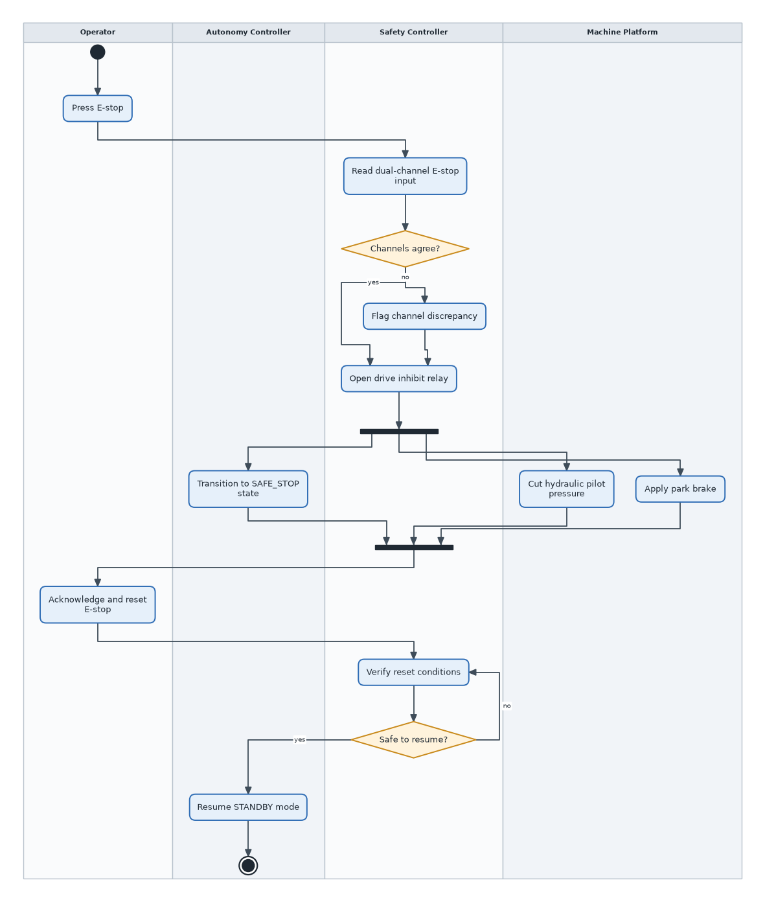
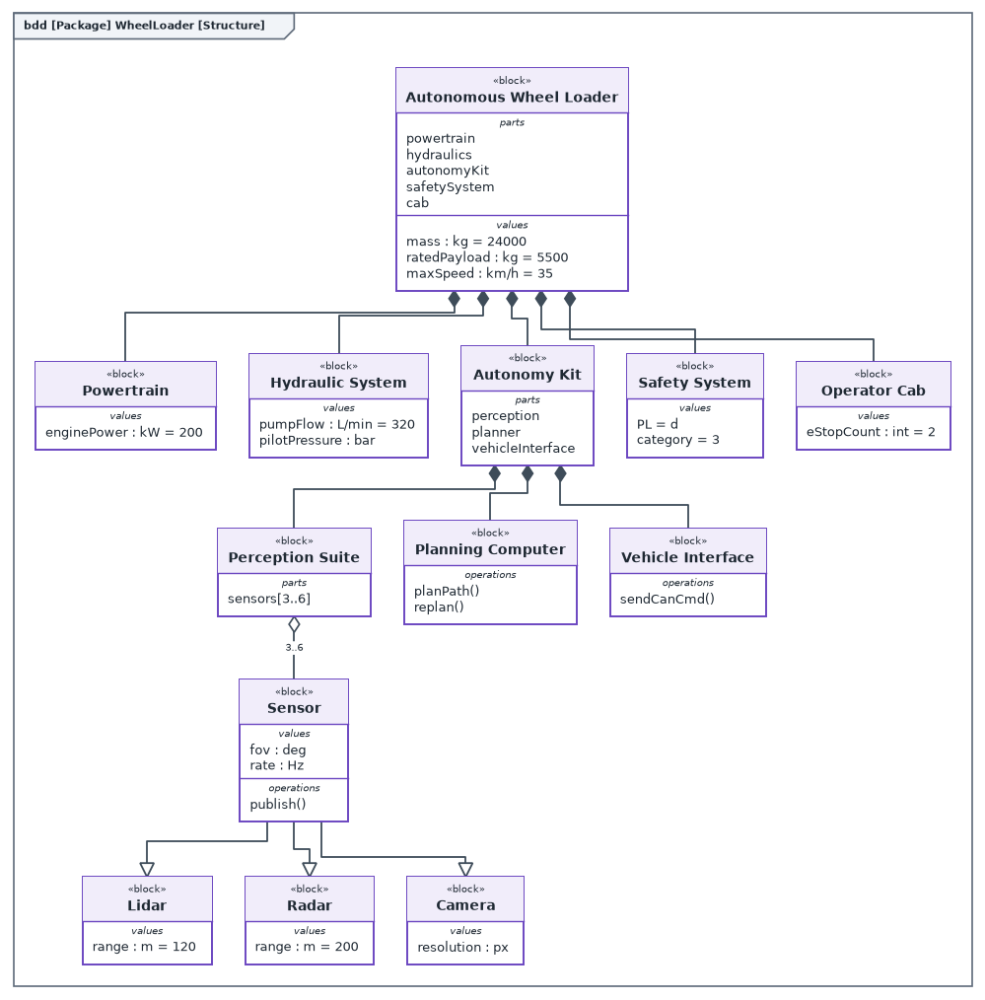
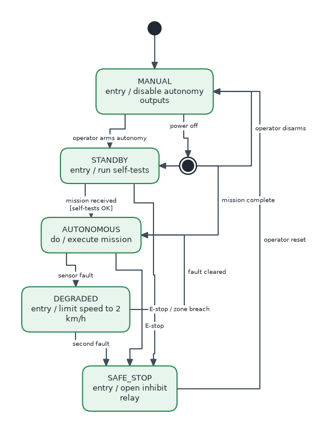

# asi_escher

One of the [ASI FuSa tools](https://github.com/c00289/c00289/blob/main/README.md) by Roy Mendoza; the master README there lists every sibling.

Pure-Python diagram generator for engineering documentation. Describe a
diagram in a few lines of Python (or a JSON file), and asi_escher lays it out
and renders it to **PNG**, **SVG**, **Graphviz DOT** and **Mermaid**, with no
Graphviz, Node or browser needed. Version **0.1.3**, alpha.

Supported diagram families:

| Family | Node kinds | Typical use |
|---|---|---|
| Activity | start, end, flowfinal, action, decision, merge, fork, join, note, object, swimlanes | processes, safety reactions, handovers between actors |
| Flowchart | io, process, document, database + the activity kinds | procedures, test routines |
| State machine | state, start, end | modes and transitions |
| SysML BDD / IBD / REQ | block, part, requirement + composition, aggregation, generalization, connector, itemflow, satisfy, derive, verify, refine, allocate | structure, interfaces, traceability |



## Install

Requires Python 3.13 or newer. The only runtime dependencies are matplotlib
and Pillow.

```bash
# for development inside this folder
uv sync

# as a dependency of another project, from a checkout
uv add --editable ../asi_escher      # or: pip install ../asi_escher
```

### From a sibling project

This repository sits next to its siblings and the `Roy's Brain` folder:

```
OneDrive - Capgemini/
├── asi_dewey/             <- primary tool: working-knowledge store
├── asi_kletz/             <- primary tool: safety plan
├── asi_escher/            <- this repo
├── asi_gutenberg/         <- document generator (depends on this repo)
├── asi_hopper/            <- gateway: read-only Jira door
└── Roy's Brain/           <- notes, corpus, datasets
```

Each consumer declares the dependency once with a uv path source. From the
asi_gutenberg folder (or any other sibling):

```bash
uv add --editable ../asi_escher
```

The command writes the two lines below into the consumer's pyproject
(with its own relative path), locks it, installs it into the consumer's
`.venv`, and from then on `from asi_escher import Diagram, build` works
there. Because the install is editable, pulling a newer asi_escher is picked
up without reinstalling; only a changed dependency list needs a `uv sync`.

```toml
[project]
dependencies = ["asi-escher"]

[tool.uv.sources]
asi-escher = { path = "../asi_escher", editable = true }
```

A pinned git source works the same way:
`asi-escher = { git = "https://github.com/c00289/asi_escher", tag = "v0.1.3" }`.

This folder lives in OneDrive, which rejects the hardlinks uv normally makes
from its cache; `pyproject.toml` therefore sets `tool.uv.link-mode = "copy"`
so plain `uv sync` works. Consumers in OneDrive need the same setting, or
`--link-mode=copy` on the command line.

## Quick start

```python
from asi_escher import Diagram, build

d = Diagram("Emergency Stop", "activity")
d.start()
d.action("press", "Press E-stop")
d.decision("agree", "Channels agree?")
d.action("inhibit", "Open drive inhibit relay")
d.action("flag", "Flag channel discrepancy")
d.end()
d.chain("start", "press", "agree")
d.edge("agree", "inhibit", "yes")
d.edge("agree", "flag", "no")
d.edge("flag", "inhibit")
d.edge("inhibit", "end")

paths = build(d, "out")        # out/emergency_stop.png / .svg / .dot / .mmd
print(paths["png"], paths["size"], paths["issues"])
```

`build()` is the one-call pipeline. The individual steps are also public when
you need control over them:

```python
from asi_escher import layout, render, to_dot, to_mermaid, LayoutOptions

layout(d, LayoutOptions(ranksep=70, nodesep=40))   # positions, edge routes, canvas size
fig = render(d, png="e.png", svg="e.svg", dpi=200)  # matplotlib Figure is returned too
dot = to_dot(d)                                     # str, paste into Graphviz
mmd = to_mermaid(d)                                 # str, paste into Markdown
```

## Command line

The package installs an `asi-escher` command (also `python -m asi_escher`).

```bash
asi-escher build diagram.json -o out            # render one or more JSON specs
asi-escher build a.json b.json --formats svg,mmd
asi-escher gallery -o out                       # all bundled examples + index.html
asi-escher example state_autonomy_modes -o out  # one bundled example
asi-escher list                                 # names of bundled examples
```

`build`, `gallery` and `example` share the options `-o/--out DIR` (default
`out`), `--dpi N` (PNG resolution, default 160), `--formats png,svg,dot,mmd`
(any subset, default all), `--ranksep PX` and `--nodesep PX` (layout spacing).
`build` also takes `--name STEM` for a single spec and reads one spec from
stdin when the file argument is `-`. `asi-escher --version` prints the
installed version.

Run `asi-escher gallery` and open `out/index.html` to see every diagram
family rendered, with its DOT and Mermaid source alongside. Layout issues
(see below) are printed to stderr per diagram.

The sixteen bundled examples (`src/asi_escher/examples.py`), all themed
around an autonomous wheel loader and its safety system:

| Family | Examples |
|---|---|
| Activity | `activity_load_cycle`, `activity_swimlanes_estop`, `activity_fork_join_post`, `activity_object_flow`, `swimlanes_lr_dispatch` |
| Flowchart | `flowchart_fault_response`, `flowchart_pipeline_lr`, `flowchart_calibration_loops`, `flowchart_fusa_lifecycle`, `stress_random_dag` |
| State machine | `state_autonomy_modes`, `state_estop_channel` |
| SysML | `bdd_wheel_loader`, `bdd_safety_system`, `ibd_safety_controller`, `req_safety_requirements` |

### JSON spec

A spec is the JSON form of `Diagram.to_dict()`. Everything except `title`,
node `id` and edge `src`/`dst` is optional.

```json
{
  "title": "Login",
  "kind": "flowchart",
  "direction": "TB",
  "lanes": [{"id": "user", "title": "User"}, {"id": "sys", "title": "System"}],
  "nodes": [
    {"id": "start", "kind": "start", "lane": "user"},
    {"id": "enter", "label": "Enter credentials", "lane": "user"},
    {"id": "check", "label": "Valid?", "kind": "decision", "lane": "sys"},
    {"id": "end", "kind": "end", "lane": "sys"}
  ],
  "edges": [
    {"src": "start", "dst": "enter"},
    {"src": "enter", "dst": "check"},
    {"src": "check", "dst": "end", "label": "yes"},
    {"src": "check", "dst": "enter", "label": "no", "style": "dashed"}
  ]
}
```

See [docs/example_spec.json](docs/example_spec.json) for a complete example.
Node fields: `id`, `label`, `kind`, `lane`, `stereotype`, `compartments`
(list of `[title, [lines]]`), `fill`, `stroke`. Edge fields: `src`, `dst`,
`label`, `kind`, `style` (`solid`, `dashed`, `dotted`), `src_port`,
`dst_port`.

## Building diagrams in Python

`Diagram(title, kind="activity", direction="TB", frame=None)`

* `kind` is one of `activity`, `flowchart`, `state`, `bdd`, `ibd`, `req`. It
  selects the Mermaid diagram type; the renderer draws any node kind in any
  diagram.
* `direction` is `TB` or `LR`.
* `frame` draws a SysML diagram frame with the given header, e.g.
  `"bdd [Package] WheelLoader"`.

Shorthand constructors: `start()`, `end()`, `action()`, `decision()`,
`merge()`, `fork()`, `join()`, `note()`, `state()`, `block()`,
`requirement()`, plus the general `node(id, label, kind, **fields)`. Edges
come from `edge(src, dst, label="", kind="flow", style="solid", src_port=None,
dst_port=None)` and `chain(*ids, labels=[...])`. Swimlanes come from
`lane(id, title)`; when a diagram has lanes, every node must name one.

Invalid input raises early: unknown kinds, duplicate ids, edges to missing
nodes and nodes outside any lane are all `ValueError`/`KeyError` at build
time, not at render time.



## Layout engine

The layout is a deterministic layered (Sugiyama-style) algorithm:

1. cycle removal by DFS back edges (back edges are routed in a channel on
   the right, or at the bottom for left-to-right diagrams);
2. longest-path layering, with side inputs such as notes pulled next to
   their consumer;
3. dummy nodes for edges that span several layers;
4. barycenter ordering, lane-aware when swimlanes are present;
5. per-component coordinate balancing and chain straightening, with
   components packed side by side;
6. orthogonal edge routing that only jogs in the gaps between layers;
7. edge-label placement that avoids nodes and other labels, with layer gaps
   widened to fit labels in left-to-right diagrams.

`LayoutOptions` exposes `ranksep`, `nodesep`, `margin`, `lane_pad`,
`lane_header`, `iterations` and `back_channel`. Text is measured with the
DejaVu Sans font bundled with matplotlib, so output is identical on every
machine.

### Layout issues

When the engine cannot find a clean result it still produces a drawing, but
it says so. After `layout()` (or `build()`), `diagram.issues` holds one
`LayoutIssue` per problem:

| kind | meaning |
|---|---|
| `label_overlap` | an edge label had to be placed touching a node or another label |
| `edge_through_node` | a routed edge segment passes through a node it does not connect |

Each issue carries a `message`, the `edge` `(src, dst)` and, where relevant,
the `node` id. A single `LayoutWarning` (a `UserWarning` subclass) is also
emitted per diagram so that hosts which do nothing special still see it;
silence it with `warnings.filterwarnings("ignore", category=LayoutWarning)`
or turn it into an error in tests. None of the bundled examples produce
issues, and the test suite enforces that.



## Using it inside a larger tool

* No global state. The renderer uses the object-oriented matplotlib API,
  never calls `pyplot`, selects no backend and restores rcParams after each
  call. It is safe inside applications that use matplotlib themselves.
* `render()` accepts file paths or file-like objects and returns the
  `Figure`, so you can write to memory, embed in a GUI or save as PDF.
* The model is plain data. `Diagram.to_dict()` / `Diagram.from_dict()` give
  a JSON-serialisable interchange format; the author's labels are never
  modified by layout (wrapped text lives in `Node.lines`).
* `layout()` can be re-run on the same diagram after edits; stale layout
  state is discarded.
* Degraded results are reported, never hidden (see Layout issues).
* The package ships `py.typed`; everything is typed, deterministic and
  covered by the test suite.

## Theming

`render(d, theme={...})` overrides any entry of `asi_escher.THEME`, a dict of
colours keyed by node kind (`(fill, stroke)` pairs) and by role (`bg`,
`edge`, `label_bg`, `lane_a`, `lane_b`, `frame`, `bar`). Individual nodes
take `fill=` and `stroke=` too.

## Development

```bash
uv sync                      # create .venv with dev tools
uv run pytest                # tests, including geometric invariants on every example
uv run ruff check src tests  # lint
uv run asi-escher gallery    # regenerate out/ for a visual check
uv build                     # wheel + sdist in dist/
```

The suite lives in `tests/`: `test_model.py` (validation and JSON round
trips), `test_layout.py` (geometric invariants), `test_issues.py` (layout
issue reporting), `test_export.py` (DOT and Mermaid) and
`test_render_pipeline.py` (renderer isolation, `build()` and the CLI);
`conftest.py` provides every bundled example as a fixture. The geometry
tests assert, for every bundled example, that nodes never overlap, edges are
orthogonal, edges never pass through unrelated nodes, all geometry and
labels fit the canvas, layout is repeatable and no layout issues are
reported.

## Limitations

* Layout quality on dense, highly cyclic graphs (see the bundled stress
  example) is readable but not pretty; Graphviz will do better on those, and
  the DOT export is there for that reason.
* Mermaid and DOT output follow the published grammars but have not been
  run through Mermaid or Graphviz on this machine, since neither is
  installed here.
* Port symbols on IBD connectors are drawn at the edge endpoints and can be
  crowded on blocks with many connectors.

## Versioning

See [CHANGELOG.md](CHANGELOG.md). Versions follow semantic versioning; while
the major version is 0 the Python API may change between minor versions.
